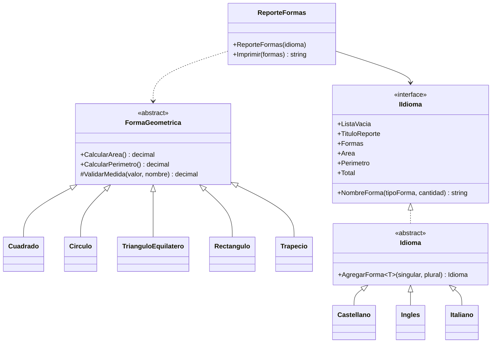

# DevelopmentChallenge

[](https://github.com/franfocaraccio/DevelopmentChallenge/actions/workflows/ci.yml)

Librería .NET Framework 4.6.2 que genera un reporte HTML de formas geométricas en distintos idiomas. Es el resultado de refactorizar la clase original `FormaGeometrica` para que agregar nuevas formas o idiomas sea simple.

## Checklist del TODO

| Requerimiento | Estado | Dónde |
|---|---|---|
| Refactorizar la clase para respetar principios de la programación orientada a objetos | ✅ | [Formas](https://github.com/franfocaraccio/DevelopmentChallenge/commit/1a2e6bc), [idiomas](https://github.com/franfocaraccio/DevelopmentChallenge/commit/1d174fa), [reporte](https://github.com/franfocaraccio/DevelopmentChallenge/commit/c473a8e), [clase base de idiomas](https://github.com/franfocaraccio/DevelopmentChallenge/commit/3564a7d). Ver [Diseño](#diseño). |
| Implementar la forma Trapecio/Rectángulo | ✅ | [Agregar formas Rectángulo y Trapecio](https://github.com/franfocaraccio/DevelopmentChallenge/commit/9fcb6dc) |
| Agregar el idioma Italiano (o el deseado) al reporte | ✅ | [Agregar idioma italiano](https://github.com/franfocaraccio/DevelopmentChallenge/commit/343fa90) |
| Incluir nuevos tests unitarios; deben pasar todos, incluso los actuales | ✅ | 44 tests pasando. Los 6 originales conservan sus resultados esperados. Ver [Tests y CI](#tests-y-ci). |
| Subir el código a un repo GIT y ofrecer la URL | ✅ | Este repositorio. |

> El comentario con el TODO original se mantiene al inicio de `FormaGeometrica.cs` solo como referencia de la consigna: todos sus puntos ya están resueltos.

## Extras

- **CI en dos regiones:** cada push compila y corre los tests con la configuración regional en `es-AR` y en `en-US`.
- **Reporte independiente de la configuración regional:** los tests originales solo pasaban en una PC en español; ahora el resultado es el mismo en cualquier PC.
- **Test de traducciones completas:** falla si alguna forma no está traducida en algún idioma.
- **Traducción de formas externas:** quien use la librería puede traducir sus propias formas con `AgregarForma<T>()`, sin modificarla.
- **Validación de medidas:** no se pueden crear formas con medidas en cero o negativas.
- **Sin dependencias externas:** se quitaron MSTest y Newtonsoft.Json, que no se usaban.

## Uso como librería

```csharp
using DevelopmentChallenge.Data.Classes;
using DevelopmentChallenge.Data.Classes.Formas;
using DevelopmentChallenge.Data.Classes.Idiomas;

var formas = new List<FormaGeometrica>
{
    new Cuadrado(5),
    new Circulo(3),
    new Trapecio(6, 4, 2)
};

var reporte = new ReporteFormas(new Italiano());
string html = reporte.Imprimir(formas);

decimal area = formas[0].CalcularArea();
```

**Formas disponibles**

| Forma | Constructor |
|---|---|
| `Cuadrado` | `(lado)` |
| `Circulo` | `(diametro)` |
| `TrianguloEquilatero` | `(lado)` |
| `Rectangulo` | `(ancho, alto)` |
| `Trapecio` | `(baseMayor, baseMenor, altura)` |

**Idiomas disponibles:** `Castellano`, `Ingles`, `Italiano`.

## Diseño



- **`FormaGeometrica`**: clase base abstracta. Cada forma calcula su propia área y su propio perímetro, y valida sus medidas al crearse.
- **`IIdioma` / `Idioma`**: los textos del reporte. `Idioma` concentra la lógica común, así cada idioma solo define sus textos y los nombres de las formas.
- **`ReporteFormas`**: arma el HTML. Agrupa las formas por tipo y no conoce ninguna forma ni idioma concreto.

## Cómo extender

- **Agregar una forma:** crear una clase que herede de `FormaGeometrica` y sumar su nombre en cada idioma con `AgregarForma<T>`. El reporte no se modifica. Ejemplo: [Agregar formas Rectángulo y Trapecio](https://github.com/franfocaraccio/DevelopmentChallenge/commit/9fcb6dc).
- **Agregar un idioma:** crear una clase que herede de `Idioma`. Nada más se modifica. Ejemplo: [Agregar idioma italiano](https://github.com/franfocaraccio/DevelopmentChallenge/commit/343fa90).
- **Traducir una forma propia desde otro proyecto**, sin modificar la librería:
  ```csharp
  var idioma = new Castellano().AgregarForma<Rombo>("Rombo", "Rombos");
  ```

Si una forma de la librería no tiene traducción en algún idioma, el test `TraduccionesTests` falla e indica cuál falta.

## Decisiones y cambios respecto al original

- La API cambió: las formas se crean con su propia clase (`new Cuadrado(5)` en lugar de `new FormaGeometrica(FormaGeometrica.Cuadrado, 5)`) y el reporte se genera con `ReporteFormas` en lugar del método estático `Imprimir`.
- El círculo recibe el **diámetro**, igual que en el código original.
- El trapecio es **isósceles**: sus lados se calculan a partir de las bases y la altura.
- Los números del reporte siempre usan coma decimal, sin importar la configuración regional de la PC. Antes, los tests fallaban en una PC configurada en inglés.
- Las líneas del reporte salen en el orden en que aparece cada tipo de forma en la lista.
- Las medidas en cero o negativas generan un error al crear la forma.
- Se quitaron las dependencias que no se usaban (MSTest y Newtonsoft.Json).
- El código, los commits y el CI están en español para seguir la línea del código existente, que ya estaba en español. En un proyecto desde cero se hubiese usado inglés.

## Tests y CI

Los tests usan NUnit y se pueden correr desde el Explorador de pruebas de Visual Studio o por consola:

```
nuget restore DevelopmentChallenge.sln
msbuild DevelopmentChallenge.sln /p:Configuration=Release
packages\NUnit.ConsoleRunner.3.11.1\tools\nunit3-console.exe DevelopmentChallenge.Data.Tests\bin\Release\DevelopmentChallenge.Data.Tests.dll
```

Cubren el reporte en los tres idiomas, el cálculo y la validación de cada forma, la independencia de la configuración regional y que todas las formas estén traducidas en todos los idiomas.

El [CI](https://github.com/franfocaraccio/DevelopmentChallenge/actions/workflows/ci.yml) compila y corre los tests en cada push con la configuración regional en `es-AR` y en `en-US`.

## Requisitos

- Visual Studio 2019 o superior.
- .NET Framework 4.6.2.
- Los paquetes NuGet se restauran automáticamente al compilar.
